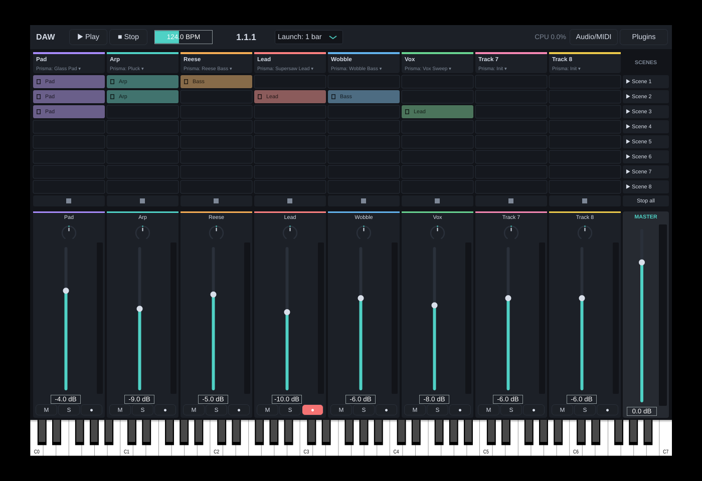

# DAW

Цифровая звуковая станция для macOS в духе Ableton Live, с собственными встроенными синтезаторами.
Архитектура и дорожная карта: [docs/ARCHITECTURE.md](docs/ARCHITECTURE.md).



## Что уже есть (фаза 0)

- **Приложение DAW**: Session View на 8 треков × 8 сцен, квантованный запуск клипов и сцен, остановка трека и всего сразу, транспорт с темпом, микшер (громкость, панорама, mute/solo/arm, индикаторы уровня), мастер-канал, экранная клавиатура, пробел = play/stop.
- **Хостинг плагинов**: сканирование и загрузка AU/VST3-инструментов любых производителей на трек, окно редактора плагина. Плагины получают темп и позицию.
- **MIDI**: все подключённые MIDI-клавиатуры и контроллеры играют трек с включённым arm (колесо модуляции, питч-бенд, сустейн, aftertouch).
- **Prisma**, встроенный wavetable-синт (тоже собирается как AU / VST3 / Standalone):
  - 2 wavetable-осциллятора, 6 встроенных таблиц с морфингом, без алиасинга (mip-уровни по октавам)
  - унисон до 16 голосов: detune, stereo spread, blend
  - суб-осциллятор, шум
  - SVF-фильтр: LP/HP 12 и 24 дБ, BP, Notch, drive, key tracking
  - 3 ADSR-огибающие, 2 LFO (6 форм, синхронизация с темпом, retrigger)
  - мод-матрица на 8 слотов (10 источников, 15 назначений)
  - 32 голоса полифонии, моно/легато, глайд, питч-бенд
  - 7 заводских пресетов: Init, Supersaw Lead, Reese Bass, Wobble Bass, Glass Pad, Pluck, Vox Sweep


Демо, отрендеренное движком без участия человека: [media/prisma_demo.mp3](media/prisma_demo.mp3).

## Сборка на Mac

Нужны Xcode (или Command Line Tools) и CMake:

```bash
brew install cmake ninja
./scripts/build-mac.sh
```

Скрипт скачает JUCE 8, соберёт universal binary (Apple Silicon + Intel), прогонит тесты и установит плагин Prisma в `~/Library/Audio/Plug-Ins`. Приложение: `build/app/DAW_artefacts/Release/DAW.app`.

Проект для Xcode: `cmake -S . -B build-xcode -G Xcode`.

## Структура

| Папка | Что внутри |
|---|---|
| `core/` | Звук и логика времени на чистом C++20 без JUCE: wavetable, фильтры, огибающие, LFO, движок Prisma, клипы, транспорт |
| `plugins/prisma/` | Prisma как плагин JUCE (процессор и интерфейс) |
| `app/` | Приложение DAW: аудио-движок, хостинг плагинов, интерфейс |
| `tests/` | Сквозные тесты JUCE-слоя на виртуальном аудиоустройстве |
| `tools/` | `prisma_render`: офлайн-рендер демо и замер производительности |

## Тесты

```bash
ctest --test-dir build --output-on-failure
```

- `daw_core_tests`: 137 проверок (отсутствие алиасинга в таблицах, высота тона, АЧХ фильтров, огибающие, голоса, пресеты, запуск клипов и отсутствие зависших нот).
- `daw_engine_tests`: 13 проверок (Prisma как AudioProcessor, сохранение состояния, запуск сцен, solo/mute, живой MIDI на armed-трек).

## Лицензия

[GNU AGPLv3](LICENSE). Проект открытый: пользоваться, изучать, изменять и распространять может кто угодно, если производные работы тоже остаются открытыми под AGPLv3. JUCE используется по своей лицензии AGPLv3.
