# DAW

A digital audio workstation for macOS with its own built-in synthesizers: a session grid for launching clips across tracks and scenes, a linear arrangement timeline, MIDI recording, audio tracks and Prisma, a built-in wavetable synth. Open source under AGPLv3.
Architecture and roadmap: [docs/ARCHITECTURE.md](docs/ARCHITECTURE.md).

> The interface is in English by default; Russian can be chosen in Settings → Appearance → Language (applies after a restart). All UI strings live in one file, `app/Source/Strings.h`, as English and Russian pairs. Screenshots below show the English UI in the Prism theme; the other themes (Neon, Studio, Paper) use the same layout.

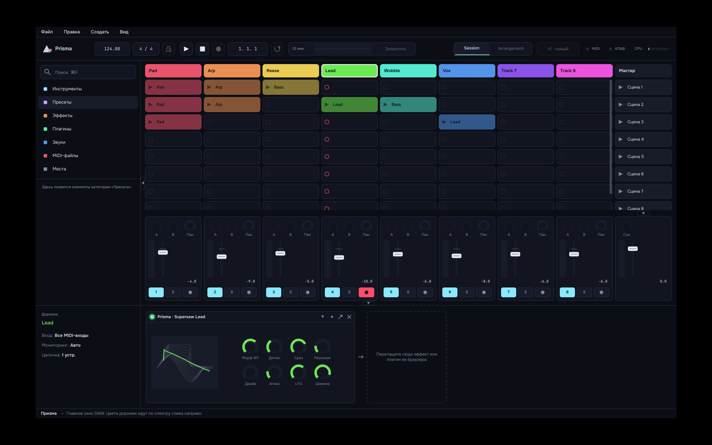

## Window, themes and menus (stage 1b)

- **Window**: top bar (tempo, time signature, play/stop, position, MIDI and computer-keyboard lamps, CPU), browser on the left (see below), Session View, a bottom panel with the device chain (8 Prisma knobs, drag to reorder devices, on/off, collapse), and an info bar with help for whatever is under the mouse. Browser width, bottom panel height and panel visibility are remembered.
- **Session View**: any number of tracks and scenes, scrolling with pinned track and scene headers, in-place renaming (double-click or Cmd+R), a 16-color palette, clip dragging (Alt copies), double-click on an empty slot creates a clip, context menus for tracks, clips and scenes. Every action is one history entry, and Cmd+Z undoes it as a whole.
- **Themes**: Prism, Neon, Studio, Paper. Tokens are JSON files (`app/Resources/themes`); your own themes go to `~/Music/Prisma DAW/User Library/Themes`. Fonts are Onest and JetBrains Mono (OFL license, files in `app/Resources/fonts`). Pick a theme in View → Theme or with the `DAW_THEME` environment variable.
- **Menus and shortcuts**: every command of the File, Edit, Create and View menus; "Export…" stays disabled until stage 4.

| Keys | Action |
|---|---|
| Space | play/stop |
| Cmd+Z / Cmd+Shift+Z | undo / redo |
| Cmd+X / C / V | cut / copy / paste a clip or scene |
| Cmd+D | duplicate |
| Delete | delete selection |
| Cmd+R | rename |
| Cmd+T | new MIDI track |
| Cmd+I / Cmd+Shift+I | new scene / capture scene |
| Cmd+Shift+M | new empty clip |
| Cmd+Alt+B / L / M | show or hide the browser / bottom panel / mixer |
| Cmd+= / Cmd+- | UI zoom |
| Cmd+F | search in the browser |
| M | play from the Mac keyboard |

## Browser, projects and settings (stage 1c)

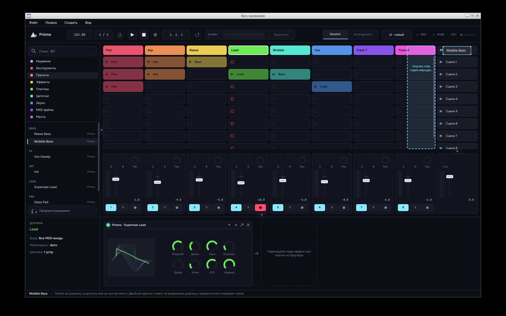

- **Browser**: "Recent", color labels and eight sections on the left (Instruments, Presets, Effects, Plugins, Chains, Sounds, MIDI files, Places). Search filters as you type, in Latin and Cyrillic, ignoring case (and treating the Cyrillic "yo" and "ye" alike). A selected Prisma preset plays a phrase at the project tempo (headphones button at the bottom, −12 dB). Right-click: color label, rename and delete your own preset, show in Finder. Folders for "Places" are added with a button in the browser itself, in Settings, or by dropping a folder from Finder.
- **Drag and drop**: from the browser onto empty Session View space (new track), onto a track (replaces the instrument), onto a slot (a MIDI file becomes a clip), onto a device in the bottom panel (a preset of the same type is applied), or into a gap in the chain (an effect). MIDI files can be dropped straight from Finder too. Every drop is one history entry, and Cmd+Z undoes it as a whole. Double-click or Enter puts the selected item on the selected track.
- **Your own presets and chains**: the triangle on a device opens a menu with "Save preset…", Prisma presets, "My presets" and instrument replacement. Right-click on a track header: "Save chain…". Files live in `~/Music/Prisma DAW/User Library` (`Presets/<device>/*.dawpreset`, `Chains/*.dawchain`) and show up in the browser immediately.
- **Project**: a `<Name> Project` folder with `<Name>.prisma` (text XML with a schema version, migrated when an older file is opened), `Backup/autosave.prisma` and `History/`. Plugin state is written to the file; on open, third-party plugins are created in the background (a spinner turns on the device), and a plugin that cannot be found stays as a "missing" device with its saved state and comes back to life when the plugin appears. Saving is atomic and runs on a background thread.
- **Autosave and recovery**: every 60 seconds if something changed. If the app quit unexpectedly (the `session.lock` marker is left behind), the next launch offers "Recover" / "Open last save" / "Don't open".
- **Version history**: the `v14 · 5 min` button in the top bar. Saves and labelled versions are kept forever; of the autosaves, the last 50 and one per hour are kept. Double-click to label a version; "Restore" first saves the current state as a "before restore" version.
- **New project** comes from `User Library/Templates/Default.prisma` (File → Save as default template); the first launch opens a demo.
- **Settings** (Cmd+,): Audio (driver, input, output, sample rate, buffer size without restart, latency in ms, channel names, 440 Hz test tone, CPU load), MIDI ("Play on tracks" per input, connect and disconnect on the fly), Appearance (theme cards, zoom, animations), Library (User Library folder, "Places", plugin rescan).

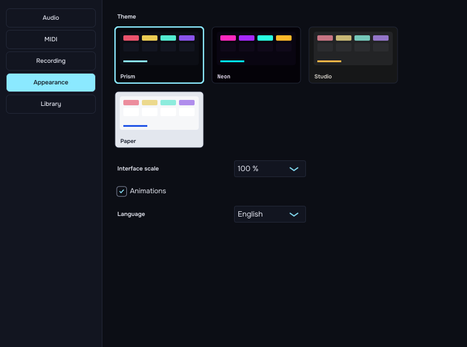

| Keys | Action |
|---|---|
| Cmd+N / Cmd+O | new / open project |
| Cmd+S / Cmd+Shift+S | save / save as |
| Cmd+, | settings |
| Enter in search | put the selected item on the track |
| Arrows in search | move through the list (with preview) |

## Clip editor and scales (stage 2, part A)

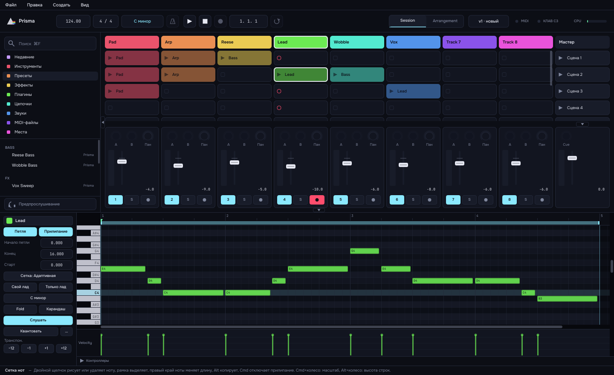

- **Open a clip**: double-click a clip in Session View (on an empty slot this first creates a one-bar clip). The bottom panel turns into a piano roll; Shift+Tab brings back the device chain, Tab switches between Session and Arrangement. The editor height is remembered separately from the chain height; double-clicking the panel border stretches it to 60 % of the window and back.
- **Notes**: double-click draws or deletes a note, a marquee selects, dragging moves (Cmd disables snapping, Alt copies), the right edge of a note changes its length, the pencil (B) draws and drags out the length. A note longer than the clip extends the clip loop to a whole bar, and the info bar says so. Every gesture is one history entry. Notes sound on the track while drawing, selecting and moving.
- **Velocity**: bars under the grid, drag up and down; Alt+drag draws a ramp across several notes. Note opacity follows velocity.
- **Clip loop**: a bracket on the ruler (edges, middle, double-click toggles it); the triangle is the start point. With the loop off the clip plays once from the start point. Cmd+L puts the loop around the selected notes.
- **Grid and view**: adaptive grid (steps of at least 12 pixels) or 1/4 … 1/64 with triplets; Cmd+1 finer, Cmd+2 coarser, Cmd+3 triplets, Cmd+4 snapping. Cmd+wheel or Cmd+= / Cmd+- zooms, Alt+wheel changes row height. Fold shows only rows with notes; "Scale only" restricts new notes and dragging to the scale.
- **Quantize**: Cmd+U on the selected notes (all notes if nothing is selected) with the project settings; Cmd+Shift+U opens a dialog: grid, strength 0–100 %, swing 0–75 %, "Quantize note ends".
- **Scales**: the "Scale" button in the top bar sets the project scale (12 roots, 13 modes); out-of-scale rows are dimmed in the editor, the root is highlighted, and a clip can have its own scale. Cmd+Shift+↑/↓ moves notes by a scale degree; the −12 −1 +1 +12 buttons in the clip panel transpose the selected notes.
- **Project properties** (Cmd+Alt+P): tempo, time signature, scale, A4 tuning (415–466 Hz, affects the built-in synths), author, notes. Track transpose (−48…+48) is on the track card at the bottom.
- **Computer keyboard**: Z/X and C/V give visible feedback: the info bar shows "Octave: C3–E4" and "Velocity: 100", the keyboard lamp shows the octave, and when the keyboard is off, Z or X hints "press M". Cmd+Alt+K slides out the on-screen keyboard (hidden by default). If the project has a scale, the A S D F G H J K L ; row plays its degrees and the black-key row is silent (the "In scale" switch on the slide-out keyboard).
- **Dropping a folder** from Finder onto the browser adds it to "Places" (the folder is linked, not copied); files are ignored.

| Keys | Action |
|---|---|
| Tab / Shift+Tab | Session and Arrangement / clip editor and chain |
| Cmd+U / Cmd+Shift+U | quantize / quantize dialog |
| Cmd+A / Cmd+Shift+A | select all / invert selection |
| Cmd+C / X / V / D | copy, cut, paste, duplicate notes |
| Cmd+E / Cmd+J | split a note at the cursor / join |
| ← → / Shift+← → | move a note / change its length by one grid step |
| ↑ ↓ / Shift+↑ ↓ | move by a semitone / an octave; Cmd+Shift+↑ ↓ by a scale degree |
| Cmd+L | loop around the selection |
| B | pencil |
| Cmd+Alt+P / Cmd+Alt+K | project properties / on-screen keyboard |

## Recording, metronome and capture (stage 2, part B)

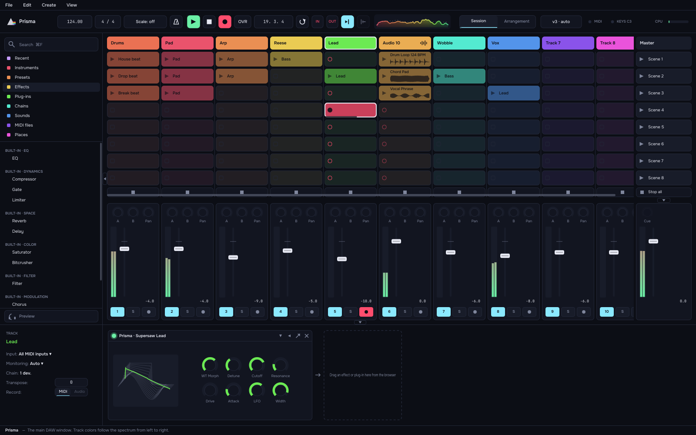

- **Metronome**: the pendulum button in the top bar turns the click on. Right-click: volume (0 … −24 dB, silent), "Only while recording", count-in (none, 1, 2 or 4 bars) and click sound (classic or wood). The downbeat is higher, and the master volume does not affect the click.
- **Count-in**: the position display counts down (`−1. 3`), the record button blinks, and a note played slightly before recording starts still lands at the start of the clip.
- **Recording into a slot**: an armed MIDI track (or the selected one if none is armed) shows red circles in its empty slots. Clicking a circle starts recording at the next launch boundary, clicking the recording slot stops at the next bar, and the clip immediately plays in a loop. While recording, the slot is red, a length bar grows and the played notes are visible. Cmd+Z removes the recorded clip as a whole.
- **Record button** (red circle in the top bar): records into the selected scene on all armed tracks; a second click stops. Right-click: fixed length (1–16 bars, recording stops by itself) and record quantization (1/4 … 1/32 with triplets).
- **OVR** (overdub): recording onto a playing clip layers new notes over the old ones. Every loop pass is a separate history entry.
- **Always-on recording and Capture**: the "10 min" strip shows everything played in the last 10 minutes, even without recording and with the transport stopped (a stroke in the track color, height by velocity). "Capture" or Cmd+Shift+C turns the last phrase into a clip on the selected track: the length is rounded to bars, and if the project is empty and the transport was stopped, the project tempo is taken from the played phrase. The info bar says what happened: "Captured 8 bars, 112 notes → Arp, scene 3".
- **Controllers**: mod wheel, pitch bend and sustain are recorded together with notes. The piano roll has a controller lane next to velocity (mod wheel, pitch bend, sustain); values are drawn with the mouse, and a whole stroke is undone with one Cmd+Z.
- **Record source**: the track card has a "MIDI | Audio" switch. Audio recording arrives in stage 5.
- **Settings → Recording**: automatic latency compensation (notes are shifted by the output latency plus half a buffer, the way the player hears them) and a manual offset in milliseconds.

| Keys | Action |
|---|---|
| Cmd+Shift+C | capture the last phrase |
| Right-click on metronome / record | metronome and count-in settings / record length and quantization |

## Arrangement (stage 3, UI part)

The Arrangement tab shows the song over time: track headers, a marker lane, the loop bracket, a bar ruler, clips, a minimap and the playhead. Clips can be moved, copied (Alt), resized by their edges, split (Cmd+E), joined (Cmd+J) and duplicated (Cmd+D); double-clicking empty space draws a one-bar clip. A Session clip can be dragged onto the Arrangement tab and then onto a track. The orange "Back to Arrangement" button returns tracks that were playing Session clips to the arrangement.

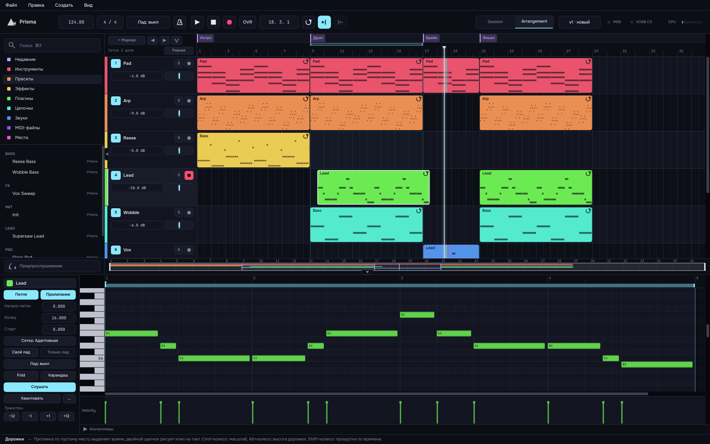

### Recording to the timeline (stage 3, part 2)

- **F9** or the ● button with Arrangement open (and the transport playing) records to the timeline: a clip grows on armed MIDI tracks, with the same count-in and metronome as in stage 2B. Recording into Session slots still works: ● in Session View with the transport stopped, the ● buttons in slots and the "Record into session slot" menu item behave as before; the "Record to timeline" item and F9 always record to the timeline.
- **Loop = takes.** With the loop on, every pass becomes a take: a new clip on top of the old one, with the earlier passes kept inside the clip. Right-click a clip → "Takes" picks a take (one undo step).
- **OVR** adds notes to the clip under the playhead instead of replacing it.
- **IN / OUT** next to the loop button: while on, recording happens only inside the loop bracket (punch-in / punch-out).
- **Session → Arrangement.** Launching and stopping Session clips while recording to the timeline turns into arrangement clips with the correct phase, all in one undo transaction.
- **Take a track from a version…** in the versions window: the chosen track of an older version (devices, Session and arrangement clips) is added to the project as "Name (vN)" with new ids, in one transaction. If the version has more scenes, scenes are added to the project.

## Audio tracks (stage 5, part 1: playback)

- **Audio track**: Create → New audio track (Cmd+Shift+T) or right-click a track header. Volume, pan, mute and solo work the same as on MIDI tracks.
- **Sounds from the browser and Finder** (WAV, AIFF, FLAC, MP3, M4A, CAF): dropped on empty space they make a new audio track, and several files go into the scenes of one track (with Cmd, each on its own track); on the timeline they stack on new tracks (with Cmd, one after another). Audio cannot be dropped on a MIDI track.
- **Project files.** Samples are copied into the project folder `Samples/Imported` (can be turned off in Settings, Library tab), and identical files are not duplicated. A missing file shows as a grey "File not found" clip; File → Find missing files… searches a chosen folder.
- **Playback** in Session and Arrangement: a clip plays at the project tempo (time-stretching without pitch change comes in stage 7), and the file's sample rate is converted to the device rate. The file tempo is read from metadata or the file name ("Loop 124 BPM"). Loop, start and fades are click-free; if the disk falls behind, a floppy-disk icon flashes in the top bar.
- **Audio clip editor** on double-click: waveform with a ruler, start marker and loop bracket (snap to 1/16; Shift/Alt/Cmd disable it), gain, transpose and detune (change pitch and speed together, re-pitch style), reverse, fades.
- **Preview**: the selected sound in the browser plays immediately when the "Preview" button is on.

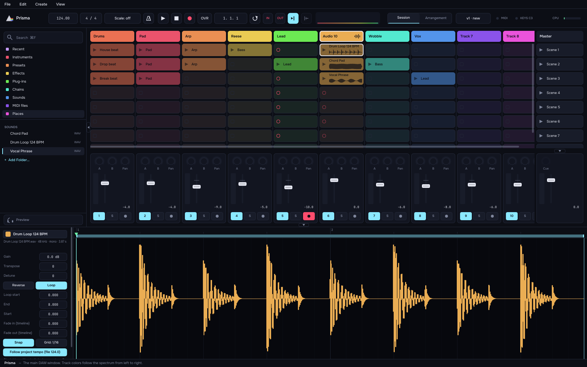

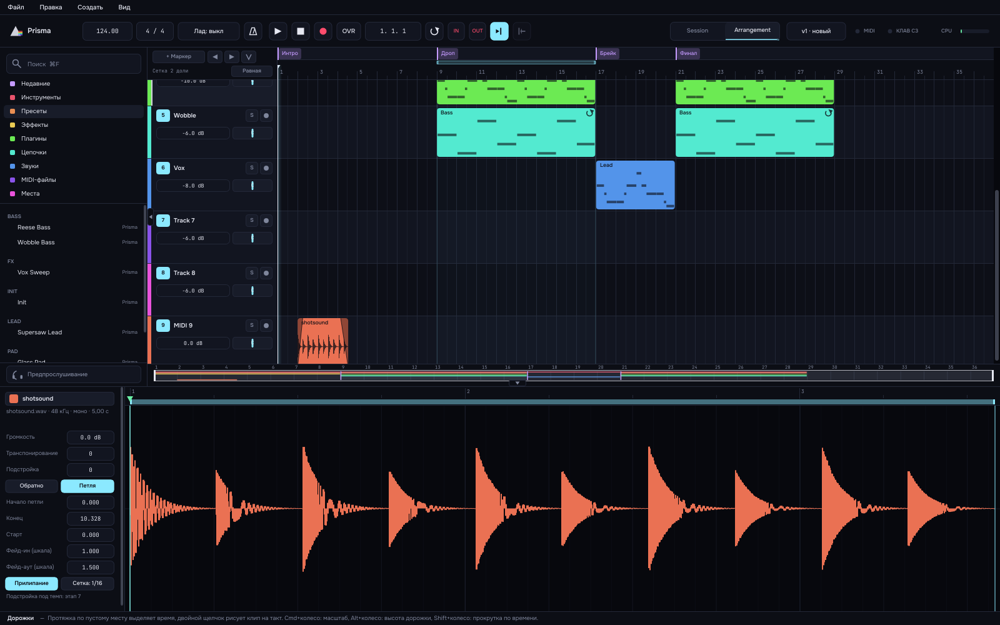

## Audio recording, effects, drums, inspiration, export (stage 5 part 2 and stage 6)

- **Audio recording.** An audio track records an input of the audio interface: the input and monitoring (Auto / In / Off) are chosen on the track card, and the input has a level meter. Recording goes into a Session slot (the circle in a slot, from the next launch boundary) or onto the timeline (F9); in a loop every pass becomes a take. The file is written by its own thread; if the disk falls behind, a silent gap of the right length is left and a warning appears. "Measure latency" in Settings measures the round trip over a cable from an output to an input and sets the correction, which can also be adjusted by hand. "Delete Unused Recordings" cleans up the project folder.
- **13 built-in effects** (the Effects category of the browser): EQ, compressor, gate, limiter, reverb, delay, saturator, bitcrusher, filter, chorus, flanger, phaser, auto pan. Drag an effect into a track's chain; its state is saved with the project.
- **Sends A / B** to return tracks (reverb and delay): a return track is made the first time a send knob is touched. **Sidechain** for the compressor and the gate: the source is chosen on the effect card.
- **Drum machine**: 16 pads, six synthesized kits, each pad with its own tune, decay, cutoff, drive, volume and pan; a sound from the browser can be dropped on a pad.
- **Create → Inspiration**: a whole idea (parts for several tracks), a single part or a new sound from the generators, all in the project scale, as one undo step. The first launch opens a demo project with drums, a compressor, reverb and delay.
- **Automation.** The **A** key (or View → Automation) switches the Arrangement to envelopes: every track has one line for volume, pan or any device parameter (chosen in the track header). Click the line to add a point, drag to move it (Alt or Cmd: no snapping), Alt-drag a segment to bend it, double-click a point to delete it, Delete clears the points in a time selection. The value is shown while dragging (dB, L/R, the parameter's text). Every gesture is one undo step.
- **Export** (Cmd+Shift+R): the whole song or the loop to WAV, AIFF or FLAC, with a choice of bit depth, peak normalization (−0.1 or −1 dBFS) and a reverb and delay tail. The render runs offline on a copy of the project.
- **Loops follow the tempo**: a loop with a known tempo is played at the project tempo by changing its speed and pitch together (Re-Pitch, a switch in the audio clip editor). The top bar shows a spectrum of the master.

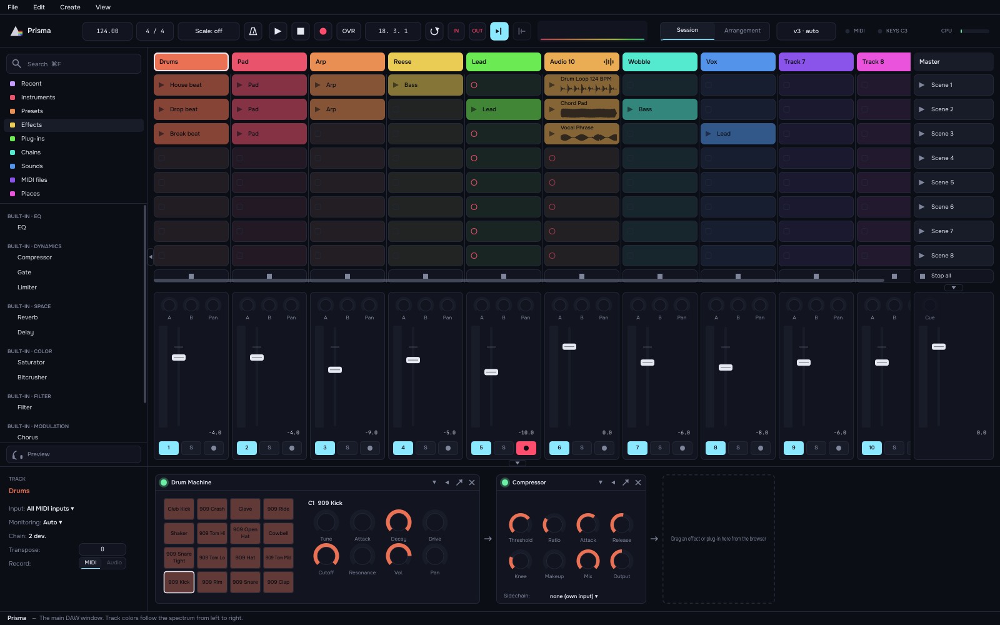

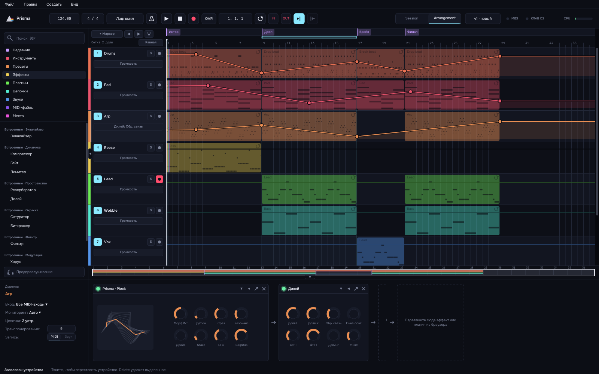

## Warp and the owner's live-test list (stage 7, part 1)

- **Warp**: an audio clip that follows the project tempo keeps its pitch. A stretched copy of the file is rendered in the background (Rubber Band), the clip plays resampled until it is ready, and export renders the copies itself. Modes: Beats for drums, Complex and Complex Pro for full mixes, Tones for voices and solo lines, Texture, and Re-Pitch (speed and pitch together). The clip editor has the Warp switch, the mode, the file tempo with ×2 and ÷2.
- **Tempo of dropped audio**: a file without a tempo in its name is analysed in the background (onsets, beat tracking, the first downbeat); its clips then follow the project tempo and start on the first beat. Loops with off-beat hats no longer read at double tempo.
- **Each track picks the timeline or Session**: the play button in an Arrangement track header starts the track's Session clip on the next bar; lit, it gives this one track back to the timeline.
- The grid shows inside clips on the timeline; waveforms stay sharp when zoomed in (sample by sample at the end); the audio clip editor zooms with the wheel or a pinch.
- "+ MIDI" and "+ Audio" under the last track, and the space below it takes sounds, instruments and MIDI files for a new track. Pan controls no longer move when the wheel scrolls past them.

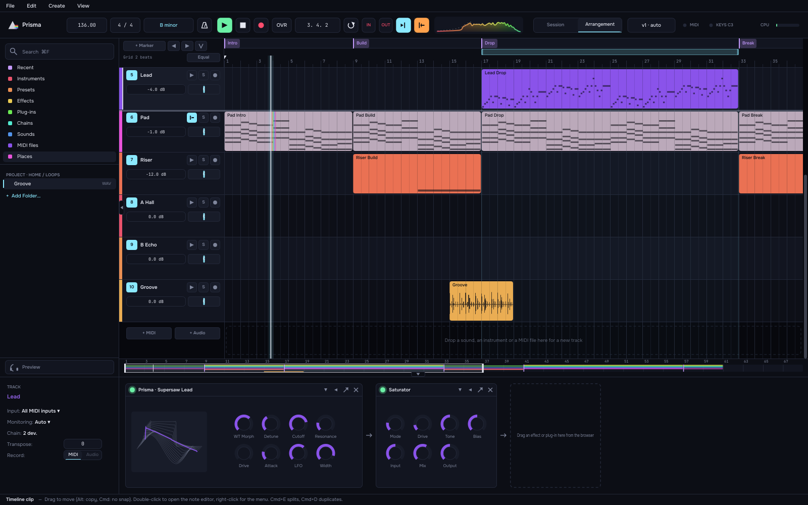

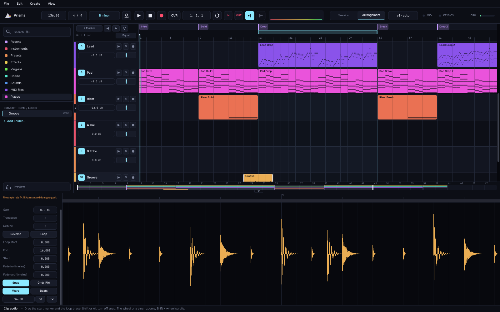

## Warp markers and the tempo of the first sound (stage 7, part 2)

- **The first sound sets the tempo.** A sound dropped into an empty project gives the project its tempo (from its name or the analysis), and its first downbeat lands on bar 1. Every later sound follows the project tempo. One undo takes back the sound and the tempo.
- **Warp markers.** The beats of the sound are drawn as faint marks above its waveform. Drag any of them, or a marker, to move that moment of the audio; the audio on both sides stretches. Cmd-drag slides the audio under a marker, double-click pins a marker, Delete removes the selected one. Markers are exact to the sample in Beats, Complex Pro, Tones and Re-Pitch.
- **A decision strip above the waveform**: the tempo found and how sure the analysis is, ×2 and ÷2, "Project Follows Clip" (the project takes the clip's tempo), and Click (the metronome, to check the grid by ear). Stretches where the grid misses the beats the analysis heard are tinted.
- **Right-click on the waveform**: Bar 1 Here, Tempo From Here, Add Markers at Onsets, Quantize Markers to Grid, Delete Marker, Clear Warp Markers; on the timeline also Slice at Onsets and Slice on Grid. Onsets show as short ticks on the wave.
- **Beats mode of its own**: the audio is cut at its onsets and every slice plays unchanged from its new place, so hits keep their attack; Decay sets how long a slice played slower keeps sounding.
- Analyses are kept on disk next to the settings (one small file per sound), so a sound is analysed once.

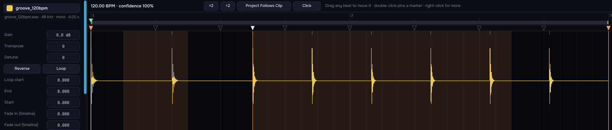

## Master, tempo, export and plug-in folders (after the demo song)

- **The master is a track.** Click the master in the Session View or the Arrangement and its chain opens at the bottom: drop built-in effects and plug-ins there like on any track. In automation mode (A) the Arrangement has a master row with Volume, Pan, the parameters of its effects and **Tempo**.
- **Tempo changes.** The Tempo envelope of the master moves the song: two points on one beat make a step, a line between points a smooth accelerando or slowdown. The tempo field shows the tempo at the cursor; changing it there speeds up or slows down the whole envelope.
- **Export** (Cmd+Shift+R): the master, stems or both from one pass (every track's share of the mix, with the same gain as the master, so they add back up); WAV, AIFF, FLAC or MP3 (320–128 kbps or VBR); normalization by peak or by loudness (−14, −16 or −9 LUFS, never above −1 dB true peak); the result reports loudness, loudness range and true peak. 16-bit files are dithered.
- **Plug-in folders.** Settings → Plug-ins lists the VST3 folders that are searched (add, remove, back to the default) with Scan Now; the plug-in window shows how many folders are searched and links there.
- **Open from the Finder**: double-click a `.prisma` file, or pass it on the command line.
- Nine new Prisma presets: Electric Keys, Drawbar Organ, Glass Bell, Music Box, String Ensemble, Brass Section, Sub Bass, Noise Riser, Laser Zap. Drum kits play 10 dB quieter, in line with the synths. Automation mode opens the envelope that is drawn; return tracks have no clip slots.

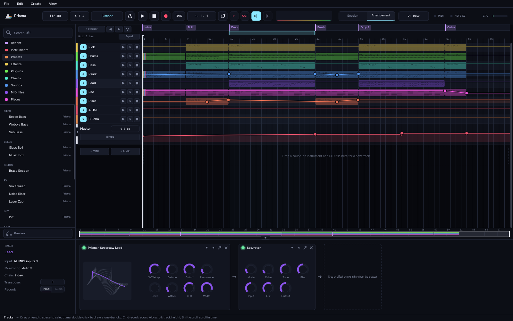

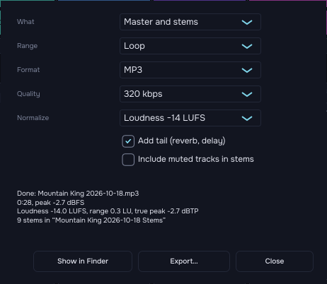

## English interface

English is the default UI language. Settings → Appearance → Language switches to Russian (and back); the choice applies after a restart. Every UI text is a `tr ("English", "Русский")` pair in `app/Source/Strings.h`, and the engine tests run once in each language.

## Demo song: "Mountain King"

An electronic arrangement of Grieg's "In the Hall of the Mountain King" (public domain), made only with the app's own instruments and effects as an end-to-end check: [listen](media/demo-mountain-king.mp3), open [the project](docs/demo/Mountain%20King.prisma), and read what the check found in [docs/demo/README.md](docs/demo/README.md).

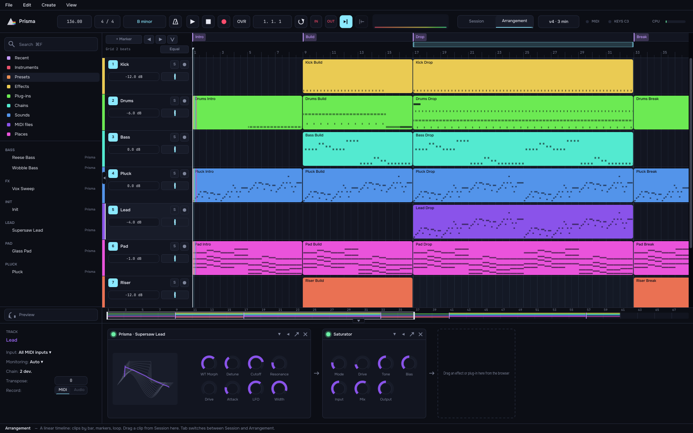

## The foundation (phase 0)

- **DAW app**: Session View with 8 tracks × 8 scenes, quantized clip and scene launching, stopping a track or everything at once, transport with tempo, mixer (volume, pan, mute/solo/arm, level meters), master channel, on-screen keyboard with Oct −/+ buttons, playing from the Mac keyboard (A W S E D F T G Y H U J K O L P ; are notes, Z/X octave, C/V velocity), Space = play/stop.
- **Plugin hosting**: scanning and loading AU/VST3 instruments from any vendor onto a track, plugin editor window. Plugins receive tempo and position.
- **MIDI**: every connected MIDI keyboard and controller plays the armed track (mod wheel, pitch bend, sustain, aftertouch).
- **Prisma**, the built-in wavetable synth (also built as AU / VST3 / Standalone):
  - 2 wavetable oscillators, 6 built-in tables with morphing, alias-free (per-octave mip levels)
  - unison up to 16 voices: detune, stereo spread, blend
  - sub oscillator, noise
  - SVF filter: LP/HP 12 and 24 dB, BP, Notch, drive, key tracking
  - 3 ADSR envelopes, 2 LFOs (6 shapes, tempo sync, retrigger)
  - 8-slot mod matrix (10 sources, 15 destinations)
  - 32-voice polyphony, mono/legato, glide, pitch bend
  - 7 factory presets: Init, Supersaw Lead, Reese Bass, Wobble Bass, Glass Pad, Pluck, Vox Sweep

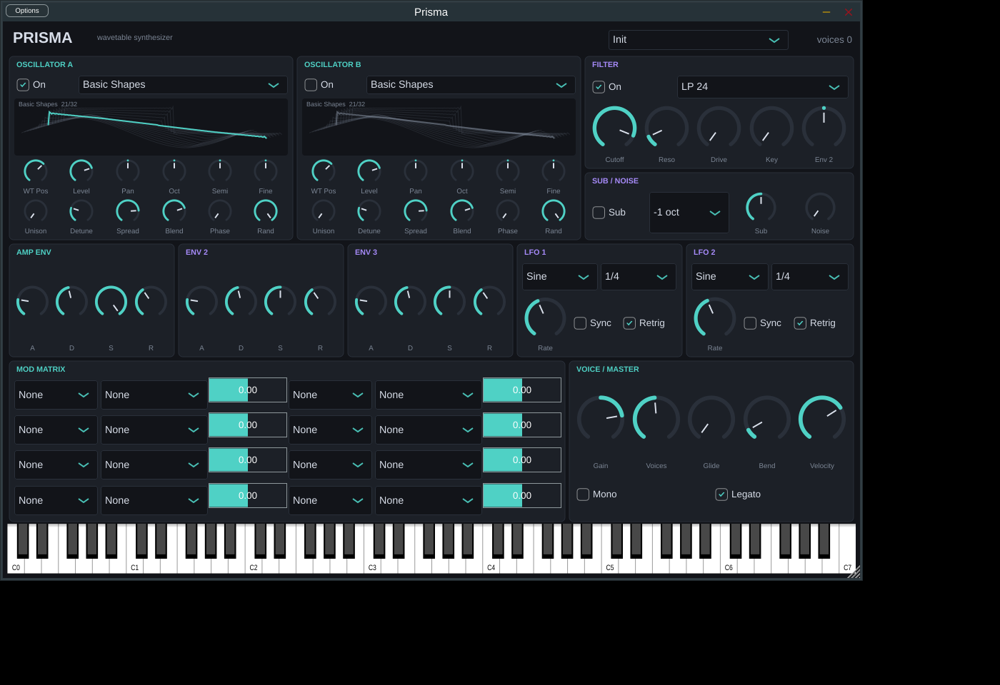

A demo rendered by the engine with no human involved: [media/prisma_demo.mp3](media/prisma_demo.mp3).

## Roadmap

Stages are specified in [docs/spec](docs/spec/README.md); the current step is always in [docs/HANDOFF.md](docs/HANDOFF.md).

- **Still open from stages 4–6**: MP3 and LUFS in export, stems, plugin delay compensation, groups, snapshots and morph, MIDI learn, comping with the mouse, always-on audio capture.
- **Stage 7**: warp (time-stretching), audio editor, tempo track.
- **Stages 8–10**: sampler and drum machine with a factory library; Prisma brought to release level; Alloy, a flagship multi-engine synth.
- Later ideas: stem separation, a DJ mode, vocal tools, mastering, an AI assistant, GPU rendering of the UI for large projects.

## Download for Mac

Latest build from the main branch: [DAW-macOS.dmg](https://github.com/Silver-Season/DAW/releases/download/nightly/DAW-macOS.dmg). It contains DAW.app, the Prisma plugin (AU, VST3, standalone app) and installation notes (`INSTALL.txt`, and `INSTALL-ru.txt` in Russian). The app is not yet signed with an Apple certificate, so on first launch macOS asks for permission: System Settings → Privacy & Security → "Open Anyway".

## Building on Mac

You need Xcode (or the Command Line Tools) and CMake:

```bash
brew install cmake ninja
./scripts/build-mac.sh
```

The script downloads JUCE 8, builds a universal binary (Apple Silicon + Intel), runs the tests and installs the Prisma plugin into `~/Library/Audio/Plug-Ins`. The app ends up in `build/app/DAW_artefacts/Release/DAW.app`.

Xcode project: `cmake -S . -B build-xcode -G Xcode`.

## Layout

| Folder | Contents |
|---|---|
| `core/` | Sound and timing logic in plain C++20 without JUCE: wavetables, filters, envelopes, LFOs, the Prisma engine, clips, transport |
| `plugins/prisma/` | Prisma as a JUCE plugin (processor and UI) |
| `app/` | The DAW app: audio engine, plugin hosting, UI, browser, project files, settings |
| `tests/` | End-to-end tests of the JUCE layer on a virtual audio device |
| `tools/` | `prisma_render`: offline demo render and performance measurement |

## Tests

```bash
ctest --test-dir build --output-on-failure
```

- `daw_core_tests`: 287 checks (among them recording notes and controllers, phrase capture and tempo detection, launching a clip mid-bar, version thinning, scales, quantize with swing, A4 tuning, clip loop and start point, alias-free wavetables, pitch, filter frequency response, envelopes, voices, presets, clip launching and no stuck notes).
- `daw_engine_tests`: 1022 checks (sample-accurate metronome and count-in, slot recording, overdub, fixed length, latency compensation, Cmd+Z after recording, capture, a 50-step gesture as one history entry, transposing live and clip notes, the Z/X/C/V keys and their messages, a Finder folder into "Places", Prisma as an AudioProcessor, scene launching, solo/mute, live MIDI, a project file that reproduces bit-identical audio, schema and migrations, a missing plugin, crash recovery, autosave and versions, browser search, every kind of browser drop, asynchronous revival of a third-party plugin, test tone and preview).

## License

[GNU AGPLv3](LICENSE). The project is open: anyone may use, study, modify and distribute it, as long as derivative works stay open under AGPLv3 too. JUCE is used under its AGPLv3 license.
