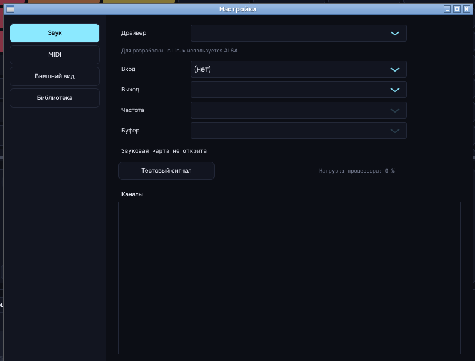
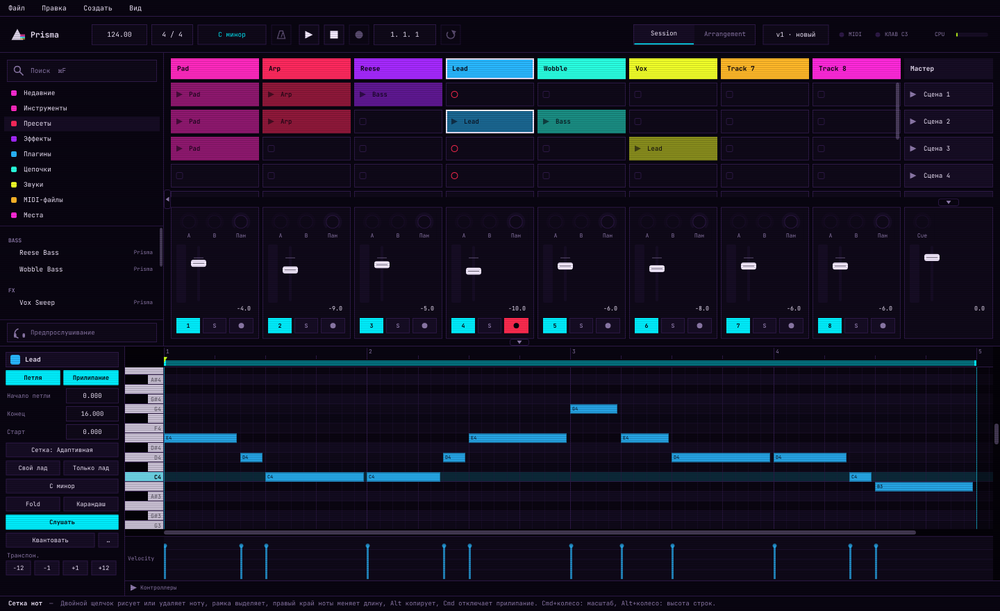
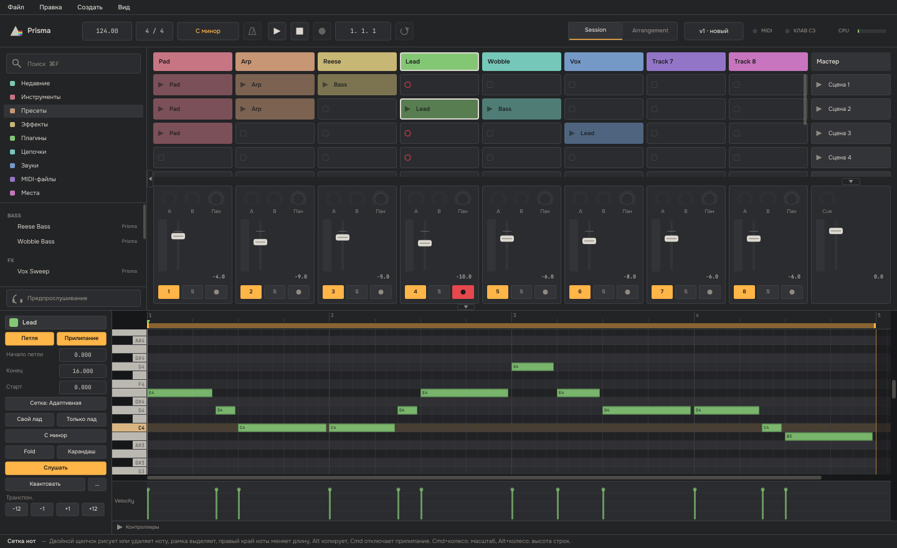
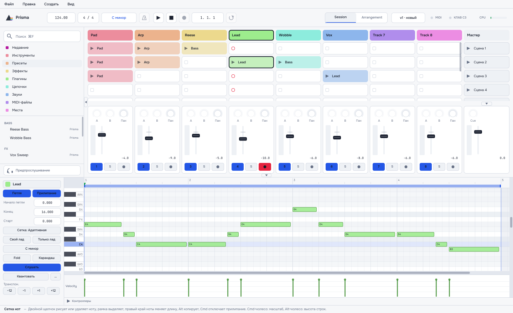
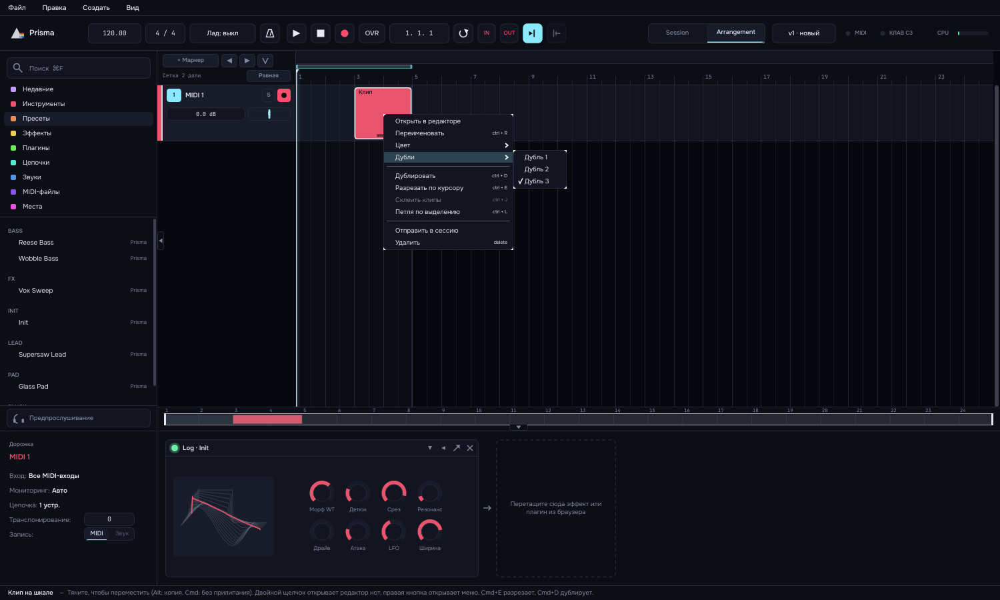
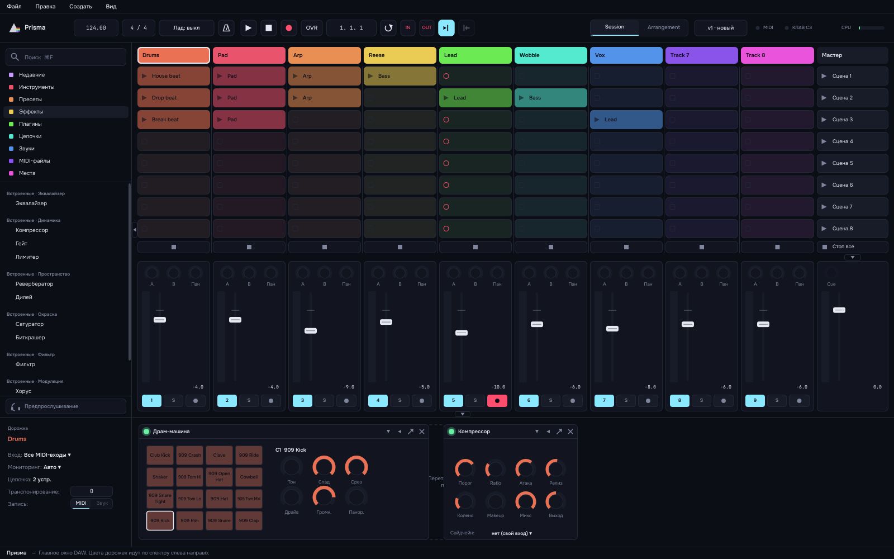

# DAW

Цифровая звуковая станция для macOS в духе Ableton Live, с собственными встроенными синтезаторами.
Архитектура и дорожная карта: [docs/ARCHITECTURE.md](docs/ARCHITECTURE.md).


## Окно, темы и меню (этап 1б)

- **Окно**: верхняя панель (темп, размер, play/stop, позиция, лампы MIDI и клавиатуры, CPU), браузер слева (см. ниже), Session View, нижняя панель с цепочкой устройств (8 ручек Prisma, перетаскивание устройств, вкл/выкл, свернуть), инфо-панель с подсказкой под курсором. Ширина браузера, высота нижней панели и видимость панелей запоминаются.
- **Session View**: любое число дорожек и сцен, прокрутка с закреплёнными заголовками дорожек и сцен, правка названий на месте (двойной клик или Cmd+R), 16 цветов палитры, перетаскивание клипа (Alt копирует), двойной клик по пустому слоту создаёт клип, контекстные меню дорожки, клипа и сцены. Каждое действие это одна запись в истории, Cmd+Z отменяет его целиком.
- **Темы**: Призма, Неон, Студия, Бумага. Токены лежат в JSON (`app/Resources/themes`), свои темы можно положить в `~/Music/Prisma DAW/User Library/Themes`. Шрифты Onest и JetBrains Mono (лицензия OFL, файлы в `app/Resources/fonts`). Тему можно выбрать в меню Вид → Тема или переменной `DAW_THEME`.
- **Меню и горячие клавиши**: все команды меню Файл, Правка, Создать и Вид; «Экспорт…» неактивен до этапа 4.

| Клавиши | Действие |
|---|---|
| Пробел | play/stop |
| Cmd+Z / Cmd+Shift+Z | отмена / повтор |
| Cmd+X / C / V | вырезать / копировать / вставить клип или сцену |
| Cmd+D | дублировать |
| Delete | удалить выбранное |
| Cmd+R | переименовать |
| Cmd+T | новая MIDI-дорожка |
| Cmd+I / Cmd+Shift+I | новая сцена / захват сцены |
| Cmd+Shift+M | новый пустой клип |
| Cmd+Alt+B / L / M | показать или скрыть браузер / нижнюю панель / микшер |
| Cmd+= / Cmd+- | масштаб интерфейса |
| Cmd+F | поиск в браузере |
| M | игра с клавиатуры Mac |

Скриншоты Session View: [Призма](media/session-prism.png), [Неон](media/session-neon.png), [Студия](media/session-studio.png), [Бумага](media/session-paper.png).

## Браузер, проекты и настройки (этап 1в)


- **Браузер**: слева «Недавние», цветные метки и восемь разделов (Инструменты, Пресеты, Эффекты, Плагины, Цепочки, Звуки, MIDI-файлы, Места). Поиск работает по мере набора, по-русски и по-латыни, без учёта регистра и «ё». Выбранный пресет Prisma проигрывается фразой в темпе проекта (кнопка с наушниками внизу, громкость −12 дБ). Правая кнопка: метка цветом, переименовать и удалить свой пресет, показать в Finder. Папки для «Мест» добавляются кнопкой в самом браузере, в настройках или перетаскиванием папки из Finder.
- **Перетаскивание**: из браузера на пустое место Session View (новая дорожка), на дорожку (заменяет инструмент), на слот (MIDI-файл становится клипом), на устройство в нижней панели (пресет того же типа применяется), в промежуток цепочки (эффект). MIDI-файл можно перетащить и прямо из Finder. Каждый сброс это одна запись истории, Cmd+Z отменяет его целиком. Двойной щелчок или Enter ставит выбранное на выбранную дорожку.
- **Свои пресеты и цепочки**: треугольник на устройстве открывает меню «Сохранить пресет…», пресеты Prisma, «Мои пресеты» и замену инструмента. Правая кнопка по заголовку дорожки: «Сохранить цепочку…». Файлы лежат в `~/Music/Prisma DAW/User Library` (`Presets/<устройство>/*.dawpreset`, `Chains/*.dawchain`) и сразу видны в браузере.
- **Проект**: папка `<Имя> Project` с файлом `<Имя>.prisma` (текст XML, версия схемы, миграции при открытии старых), `Backup/autosave.prisma` и `History/`. Состояние плагинов пишется в файл; при открытии сторонние плагины создаются в фоне (на устройстве крутится индикатор), не найденный плагин остаётся устройством «missing» с сохранённым состоянием и оживает, когда плагин появится. Запись атомарная и идёт в фоновом потоке.
- **Автосохранение и восстановление**: раз в 60 секунд, если есть изменения. Если приложение закрылось аварийно (метка `session.lock` осталась), при запуске предлагается «Восстановить» / «Открыть последнее сохранение» / «Не открывать».
- **История версий**: кнопка `v14 · 5 мин` в верхней панели. Сохранения и версии с метками живут вечно, из автосохранений остаются последние 50 и по одной на каждый час. Метка по двойному щелчку, «Восстановить» сначала сохраняет текущее состояние как версию «до возврата».
- **Новый проект** берётся из `User Library/Templates/Default.prisma` (Файл → Сохранить как шаблон по умолчанию), при первом запуске открывается демо.
- **Настройки** (Cmd+,): Звук (драйвер, вход, выход, частота, буфер без перезапуска, задержка в мс, имена каналов, тестовый сигнал 440 Гц, нагрузка CPU), MIDI (по каждому входу «Игра на дорожках», подключение и отключение на лету), Внешний вид (темы карточками, масштаб, анимации), Библиотека (папка User Library, «Места», повторное сканирование плагинов).



| Клавиши | Действие |
|---|---|
| Cmd+N / Cmd+O | новый / открыть проект |
| Cmd+S / Cmd+Shift+S | сохранить / сохранить как |
| Cmd+, | настройки |
| Enter в поиске | поставить выбранное на дорожку |
| Стрелки в поиске | перемещение по списку (и предпрослушивание) |

## Редактор клипа и лады (этап 2, часть А)


- **Открыть клип**: двойной щелчок по клипу в Session View (по пустому слоту сначала создаёт клип на такт). Нижняя панель превращается в piano roll, Shift+Tab возвращает цепочку устройств, Tab переключает Session и Arrangement (до этапа 3 Arrangement это заглушка с линейкой). Высота редактора запоминается отдельно от высоты цепочки, двойной щелчок по границе панели растягивает её до 60 % окна и обратно.
- **Ноты**: двойной щелчок рисует ноту или удаляет её, рамка выделяет, перетаскивание двигает (Cmd отключает прилипание, Alt копирует), правый край ноты меняет длину, карандаш (B) рисует и тянет длину. Нота длиннее клипа удлиняет петлю клипа до целого такта, инфо-панель сообщает об этом. Любой жест это одна запись истории. Нота звучит на дорожке при рисовании, выделении и переносе.
- **Velocity**: столбики под сеткой, тянуть вверх и вниз, Alt+тянуть рисует рампу по нескольким нотам. Прозрачность ноты следует за velocity.
- **Петля клипа**: скобка на линейке (края, середина, двойной щелчок включает и выключает), треугольник это точка старта. Выключенная петля играет клип один раз с точки старта. Cmd+L ставит петлю вокруг выделенных нот.
- **Сетка и вид**: адаптивная сетка (шаг не меньше 12 пикселей) или 1/4 … 1/64 с триолями, Cmd+1 мельче, Cmd+2 крупнее, Cmd+3 триоли, Cmd+4 прилипание. Cmd+колесо или Cmd+= / Cmd+- масштаб, Alt+колесо высота строк. Fold показывает только строки с нотами, «Только лад» ограничивает новые ноты и перетаскивание ладом.
- **Квантизация**: Cmd+U по выделенным нотам (если ничего не выделено, по всем) с настройками проекта, Cmd+Shift+U открывает окно: сетка, сила 0–100 %, свинг 0–75 %, «Квантовать концы нот».
- **Лады**: кнопка «Лад» в верхней панели задаёт лад проекта (12 тоник, 13 ладов), в редакторе строки вне лада затемнены, тоника подсвечена, а у клипа может быть свой лад. Cmd+Shift+↑/↓ двигает ноты на ступень лада, кнопки −12 −1 +1 +12 в панели клипа транспонируют выделенные ноты.
- **Свойства проекта** (Cmd+Alt+P): темп, размер, лад, строй A4 (415–466 Гц, влияет на встроенные синтезаторы), автор, заметки. Транспонирование дорожки (−48…+48) стоит в карточке дорожки внизу.
- **Клавиатура**: Z/X и C/V работают видимо: инфо-панель показывает «Октава: C3–E4» и «Сила: 100», лампа «КЛАВ C3» показывает октаву, а при выключенной клавиатуре Z или X подсказывают «нажмите M». Cmd+Alt+K выдвигает экранную клавиатуру (по умолчанию скрыта). Если у проекта есть лад, клавиши ряда A S D F G H J K L ; играют его ступени, чёрный ряд молчит (переключатель «В ладу» в выдвижной клавиатуре).
- **Перетаскивание папки** из Finder на браузер добавляет её в «Места» (папка подключается, не копируется), файл игнорируется.

| Клавиши | Действие |
|---|---|
| Tab / Shift+Tab | Session и Arrangement / редактор клипа и цепочка |
| Cmd+U / Cmd+Shift+U | квантизация / окно квантизации |
| Cmd+A / Cmd+Shift+A | выделить все / инвертировать |
| Cmd+C / X / V / D | копировать, вырезать, вставить, дублировать ноты |
| Cmd+E / Cmd+J | разрезать ноту у курсора / склеить |
| ← → / Shift+← → | сдвиг ноты / её длины на шаг сетки |
| ↑ ↓ / Shift+↑ ↓ | сдвиг на полутон / октаву, Cmd+Shift+↑ ↓ на ступень лада |
| Cmd+L | петля вокруг выделения |
| B | карандаш |
| Cmd+Alt+P / Cmd+Alt+K | свойства проекта / экранная клавиатура |





## Запись, метроном и захват (этап 2, часть Б)


- **Метроном**: кнопка с маятником в верхней панели включает клик. Правая кнопка: громкость (0 … −24 дБ, без звука), «Только во время записи», отсчёт (нет, 1, 2 или 4 такта) и звук клика (классический или дерево). Сильная доля звучит выше, громкость мастера на клик не влияет.
- **Отсчёт**: во время отсчёта позиция показывает обратный счёт (`−1. 3`), кнопка записи мигает, нота, взятая чуть раньше начала записи, всё равно попадает в начало клипа.
- **Запись в слот**: у взведённой MIDI-дорожки (или у выбранной, если ни одна не взведена) в пустых слотах красные кружки. Щелчок по кружку начинает запись на ближайшей границе запуска, щелчок по записываемому слоту заканчивает её на ближайшем такте, и клип сразу играет по кругу. Пока идёт запись, слот красный, по нему растёт полоска длины и видны сыгранные ноты. Cmd+Z удаляет записанный клип целиком.
- **Кнопка записи** (красный круг в верхней панели): запись в выбранную сцену на всех взведённых дорожках, повторный щелчок останавливает. Правая кнопка: фиксированная длина (1–16 тактов, запись сама закончится) и квантизация записи (1/4 … 1/32 с триолями).
- **OVR** (overdub): запись на играющий клип добавляет ноты слоями поверх старых. Каждый круг это отдельная запись истории.
- **Вечная запись и «Захватить»**: лента «10 мин» показывает всё, что сыграно за последние 10 минут, даже без записи и при остановленном транспорте (штрих цвета дорожки, высота по силе нажатия). «Захватить» или Cmd+Shift+C превращает последнюю фразу в клип на выбранной дорожке: длина округляется до тактов, а если проект пустой и транспорт стоял, темп проекта берётся из сыгранной фразы. Инфо-панель пишет, что получилось: «Захвачено 8 тактов, 112 нот → Arp, сцена 3».
- **Контроллеры**: колесо модуляции, питч-бенд и сустейн записываются вместе с нотами. В piano roll рядом с velocity есть полоса контроллера (модуляция, питч-бенд, сустейн), значения рисуются мышью, весь мазок отменяется одним Cmd+Z.
- **Источник записи**: в карточке дорожки переключатель «MIDI | Звук». Запись звука появится на этапе 5.
- **Настройки → Запись**: автоматическая компенсация задержки (ноты сдвигаются на задержку выхода и полбуфера, как их слышит игрок) и ручная поправка в миллисекундах.

| Клавиши | Действие |
|---|---|
| Cmd+Shift+C | захватить последнюю фразу |
| Правая кнопка по метроному / записи | настройки метронома и отсчёта / длина и квантизация записи |

Запись в темах [Неон](media/record-neon.png), [Студия](media/record-studio.png), [Бумага](media/record-paper.png), отсчёт: [count-in.png](media/count-in.png).

## Аранжировка (этап 3, часть интерфейса)

Вкладка Arrangement показывает песню по времени: заголовки дорожек, полоса маркеров, скобка петли, линейка тактов, клипы, мини-карта и луч воспроизведения. Клипы двигаются, копируются (Alt), растягиваются за края, режутся (Cmd+E), склеиваются (Cmd+J), дублируются (Cmd+D); двойной щелчок по пустому месту рисует клип в такт. Клип из Session можно перетащить на вкладку Arrangement и дальше на дорожку. Оранжевая кнопка «Вернуть аранжировку» возвращает дорожки, которые играли сессию, к аранжировке.


### Запись на шкалу (этап 3, часть 2)

- **F9** или кнопка ● при открытом Arrangement (и при играющем транспорте) пишет на шкалу: на взведённых MIDI-дорожках растёт клип, отсчёт и метроном те же, что в этапе 2Б. Запись в слот сессии остаётся: ● в Session View при остановленном транспорте, кнопки ● в слотах и пункт меню «Записать в слот сессии» работают как раньше; пункт «Записать на шкалу» и F9 всегда пишут на шкалу.
- **Петля = дубли.** С включённой петлёй каждый круг становится дублем: новый клип поверх старого, прежние круги лежат внутри клипа. Правая кнопка по клипу, «Дубли», выбирает дубль (одно действие отмены).
- **OVR** добавляет ноты в клип под курсором вместо замены.
- **IN / OUT** рядом с кнопкой петли: пока включены, запись идёт только внутри скобки петли.
- **Session → Arrangement.** Запуски и остановки клипов Session во время записи на шкалу превращаются в клипы аранжировки с верной фазой, всё одной транзакцией отмены.
- **Забрать дорожку…** в окне версий: выбранная дорожка старой версии (устройства, клипы Session и аранжировки) добавляется в проект как «Имя (vN)» с новыми id, одной транзакцией. Если у версии больше сцен, проекту добавляются сцены.



## Аудиодорожки (этап 5, часть 1: воспроизведение)

- **Аудиодорожка**: «Создать → Новая аудиодорожка» (Cmd+Shift+T) или правая кнопка по заголовку дорожки. Громкость, панорама, mute и solo те же, что у MIDI.
- **Звуки из браузера и Finder** (WAV, AIFF, FLAC, MP3, M4A, CAF): на пустое место — новая аудиодорожка, несколько файлов ложатся по сценам одной дорожки (с Cmd каждый на свою дорожку); на шкале — друг под другом на новых дорожках (с Cmd один за другим). На MIDI-дорожку звук не кладётся.
- **Файлы проекта.** Сэмплы копируются в папку проекта `Samples/Imported` (выключается в настройках, вкладка «Библиотека»), одинаковые файлы не дублируются. Пропавший файл показан серым клипом «Файл не найден»; «Файл → Найти потерянные файлы…» ищет их в выбранной папке.
- **Воспроизведение** в Session и Arrangement: клип играет по темпу проекта (растяжение без смены высоты придёт на этапе 7), частота файла пересчитывается под карту. Темп файла берётся из метаданных или имени («Loop 124 BPM»). Петля, старт и фейды без щелчков; если диск не успевает, в верхней панели на миг появляется значок дискеты.
- **Редактор аудиоклипа** по двойному щелчку: волна с линейкой, маркер старта и скобка петли (прилипание к 1/16, Shift/Alt/Cmd выключают), громкость, транспонирование и подстройка (меняют высоту и скорость, как Re-Pitch), реверс, фейды.
- **Предпрослушивание**: выбранный звук в браузере сразу играет, если включена кнопка «Предпрослушивание».


## Этап 5, часть 2 и этап 6: запись звука, эффекты, барабаны, вдохновение, экспорт

- **Запись звука.** Аудиодорожка пишет вход звуковой карты: вход и мониторинг (Авто / Вход / Выкл) выбираются в карточке дорожки, у входа есть индикатор уровня. Запись идёт в слот сессии (кружок в слоте, с ближайшей границы запуска) или на шкалу (F9); в петле каждый круг становится дублем. Файл пишется отдельным потоком, при нехватке диска остаётся тихий промежуток нужной длины и появляется предупреждение. «Измерить задержку» в настройках по кабелю выход → вход меряет круговую задержку и подставляет поправку, вручную её можно подправить. «Удалить неиспользуемые записи» чистит папку проекта.
- **13 встроенных эффектов** (вкладка «Эффекты» в браузере): эквалайзер, компрессор, гейт, лимитер, ревербератор, дилей, сатуратор, биткрашер, фильтр, хорус, флэнжер, фейзер, авто-пан. Эффект перетаскивается в цепочку дорожки, состояние сохраняется с проектом.
- **Посылы A / B** на возвратные дорожки (ревербератор и дилей): возвратная дорожка создаётся при первом касании ручки посыла. **Сайдчейн** для компрессора и гейта: источник выбирается в карточке эффекта.
- **Драм-машина**: 16 пэдов, шесть синтезированных наборов (kits), у каждого пэда свои тон, спад, срез, драйв, громкость и панорама; звук из браузера можно бросить на пэд.
- **Создать → Вдохновение**: целая идея (партии для нескольких дорожек), отдельная партия или новый звук от генераторов, всё в ладу проекта, одним действием отмены. При первом запуске открывается демо-проект с барабанами, компрессором, ревербератором и дилеем.
- **Автоматизация.** Клавиша **A** (или «Вид → Автоматизация») включает режим огибающих в Arrangement: на каждой дорожке одна линия: громкость, панорама или любой параметр устройства (список в заголовке дорожки). Щелчок по линии ставит точку, перетаскивание двигает её (Alt или Cmd: без привязки к сетке), Alt+протяжка по отрезку изгибает его, двойной щелчок по точке удаляет, Delete при выделенном времени чистит точки в нём. Значение показывается во время перетаскивания (дБ, L/R, текст параметра). Каждый жест одно действие отмены.
- **Экспорт** (Cmd+Shift+R): вся песня или петля в WAV, AIFF или FLAC, разрядность на выбор, нормализация по пику (−0,1 или −1 dBFS), хвост ревера и дилея. Рендер идёт офлайн на копии проекта.





Те же экраны в других темах: [Неон](media/stage6-automation-neon.png), [Студия](media/stage6-automation-studio.png), [Бумага](media/stage6-automation-paper.png) (автоматизация); `media/stage6-session-drums-<тема>.png` и `media/stage6-browser-effects-<тема>.png`.

## Что уже есть (фаза 0)

- **Приложение DAW**: Session View на 8 треков × 8 сцен, квантованный запуск клипов и сцен, остановка трека и всего сразу, транспорт с темпом, микшер (громкость, панорама, mute/solo/arm, индикаторы уровня), мастер-канал, экранная клавиатура с кнопками Oct −/+, игра с клавиатуры Mac как в Ableton (A W S E D F T G Y H U J K O L P ; — ноты, Z/X — октава, C/V — сила нажатия), пробел = play/stop.
- **Хостинг плагинов**: сканирование и загрузка AU/VST3-инструментов любых производителей на трек, окно редактора плагина. Плагины получают темп и позицию.
- **MIDI**: все подключённые MIDI-клавиатуры и контроллеры играют трек с включённым arm (колесо модуляции, питч-бенд, сустейн, aftertouch).
- **Prisma**, встроенный wavetable-синт (тоже собирается как AU / VST3 / Standalone):
  - 2 wavetable-осциллятора, 6 встроенных таблиц с морфингом, без алиасинга (mip-уровни по октавам)
  - унисон до 16 голосов: detune, stereo spread, blend
  - суб-осциллятор, шум
  - SVF-фильтр: LP/HP 12 и 24 дБ, BP, Notch, drive, key tracking
  - 3 ADSR-огибающие, 2 LFO (6 форм, синхронизация с темпом, retrigger)
  - мод-матрица на 8 слотов (10 источников, 15 назначений)
  - 32 голоса полифонии, моно/легато, глайд, питч-бенд
  - 7 заводских пресетов: Init, Supersaw Lead, Reese Bass, Wobble Bass, Glass Pad, Pluck, Vox Sweep


Демо, отрендеренное движком без участия человека: [media/prisma_demo.mp3](media/prisma_demo.mp3).

## Скачать для Mac

Свежая сборка из ветки main: [DAW-macOS.dmg](https://github.com/Silver-Season/DAW/releases/download/nightly/DAW-macOS.dmg). Внутри DAW.app, плагин Prisma (AU, VST3, отдельное приложение) и инструкция по установке `INSTALL-ru.txt`. Программа пока не подписана сертификатом Apple, поэтому при первом запуске macOS попросит разрешение: Системные настройки → Конфиденциальность и безопасность → «Всё равно открыть».

## Сборка на Mac

Нужны Xcode (или Command Line Tools) и CMake:

```bash
brew install cmake ninja
./scripts/build-mac.sh
```

Скрипт скачает JUCE 8, соберёт universal binary (Apple Silicon + Intel), прогонит тесты и установит плагин Prisma в `~/Library/Audio/Plug-Ins`. Приложение: `build/app/DAW_artefacts/Release/DAW.app`.

Проект для Xcode: `cmake -S . -B build-xcode -G Xcode`.

## Структура

| Папка | Что внутри |
|---|---|
| `core/` | Звук и логика времени на чистом C++20 без JUCE: wavetable, фильтры, огибающие, LFO, движок Prisma, клипы, транспорт |
| `plugins/prisma/` | Prisma как плагин JUCE (процессор и интерфейс) |
| `app/` | Приложение DAW: аудио-движок, хостинг плагинов, интерфейс, браузер, файлы проекта, настройки |
| `tests/` | Сквозные тесты JUCE-слоя на виртуальном аудиоустройстве |
| `tools/` | `prisma_render`: офлайн-рендер демо и замер производительности |

## Тесты

```bash
ctest --test-dir build --output-on-failure
```

- `daw_core_tests`: 287 проверок (в том числе запись нот и контроллеров, захват фразы и угадывание темпа, запуск клипа с середины такта, прореживание версий, лады, квантизация со свингом, строй A4, петля и точка старта клипа) (отсутствие алиасинга в таблицах, высота тона, АЧХ фильтров, огибающие, голоса, пресеты, запуск клипов и отсутствие зависших нот).
- `daw_engine_tests`: 1022 проверки (метроном и отсчёт с точностью до сэмпла, запись в слот, overdub, фиксированная длина, компенсация задержки, Cmd+Z после записи, захват, жест из 50 шагов это одна запись истории, транспонирование живых и клиповых нот, клавиши Z/X/C/V и их сообщения, папка из Finder в «Места», Prisma как AudioProcessor, запуск сцен, solo/mute, живой MIDI, файл проекта с побитово тем же звуком, схема и миграции, потерянный плагин, восстановление после сбоя, автосохранение и версии, поиск в браузере, все виды сброса из браузера, асинхронное оживление стороннего плагина, тестовый сигнал и предпрослушивание).

## Лицензия

[GNU AGPLv3](LICENSE). Проект открытый: пользоваться, изучать, изменять и распространять может кто угодно, если производные работы тоже остаются открытыми под AGPLv3. JUCE используется по своей лицензии AGPLv3.
