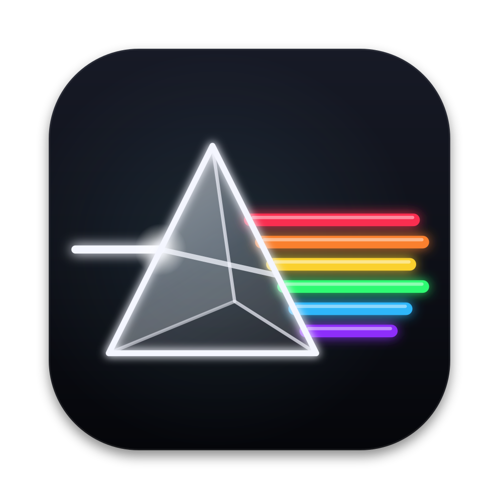

# Prisma DAW

An open-source digital audio workstation for macOS. Build ideas in a Session grid, arrange them on a timeline, record MIDI and audio, and shape the sound with the Prisma wavetable synth, drums and built-in effects.

**macOS 11+ · Apple Silicon & Intel · C++20 / JUCE 8 · English & Russian · AGPLv3**

> **Upcoming build preview — [PR #31](https://github.com/Silver-Season/DAW/pull/31).** The glass screenshots, explicit track power / Stop controls, 44-program factory bank and dedicated Distortion on this page show the tested upcoming build. The current nightly from `main` has 16 Prisma programs and 13 built-in effects; the preview changes arrive after review and merge.


[Download for Mac](#download-for-mac) · [Screenshots](#screenshots) · [Listen](#listen) · [Build](#build-from-source) · [Feature guide](docs/FEATURE-GUIDE.md)

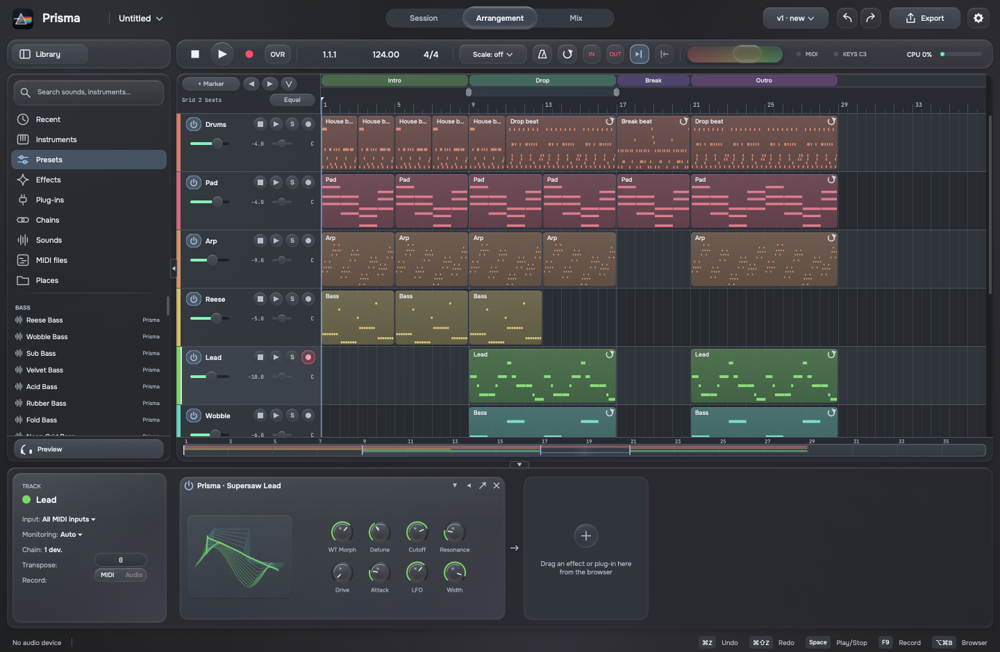

## Make a track

- **Session and Arrangement.** Launch clips and scenes, switch individual tracks between Session and the timeline, build sections with markers, loop, split, trim and duplicate clips.
- **MIDI and audio recording.** Metronome, count-in, overdub, punch-in/out, loop takes, input monitoring and MIDI phrase capture. Record a Session performance into the timeline.
- **Prisma.** Two morphing wavetable oscillators, unison, sub and noise, a driven filter, three envelopes, two LFOs and an eight-slot modulation matrix. Mono/legato, glide and 32-voice polyphony; also available as AU, VST3 and a standalone instrument.
- **Drums and inspiration.** A 16-pad drum machine with synthesized kits and sample drops; scale-aware generators for parts, sounds and multi-track ideas.
- **Mix and automate.** Fourteen built-in effects, AU/VST3 hosting, sends and returns, sidechain, track and device automation, master and tempo envelopes. Mixing controls are available in Session and the device chain.
- **Edit audio.** Waveforms down to individual samples, tempo analysis, warp markers, slicing and tempo-following stretch modes.
- **Export.** Offline master and stem rendering to WAV, AIFF, FLAC or MP3, peak/LUFS normalization, true-peak measurement and 16-bit dither.
- **Keep your work.** Atomic saves, autosave recovery, labelled versions, track import from a version, reusable presets and device chains.

## Screenshots

Native captures from the application, in Glass · Light and Glass · Dark. Open any image to inspect it at full size.

| Session · Light | Session · Dark |
|:---:|:---:|
| 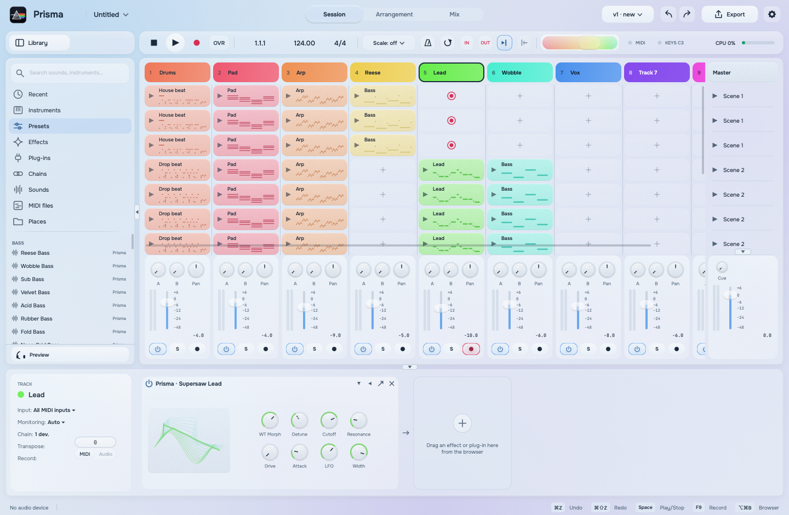 | 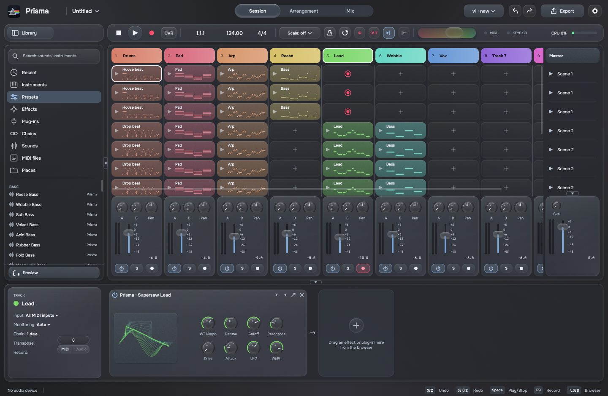 |

| Piano roll · Light | Prisma — Neon Grid Bass · Dark |
|:---:|:---:|
| 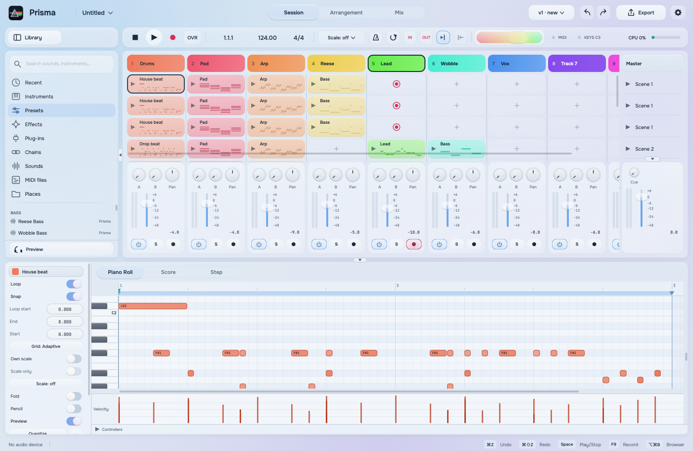 | 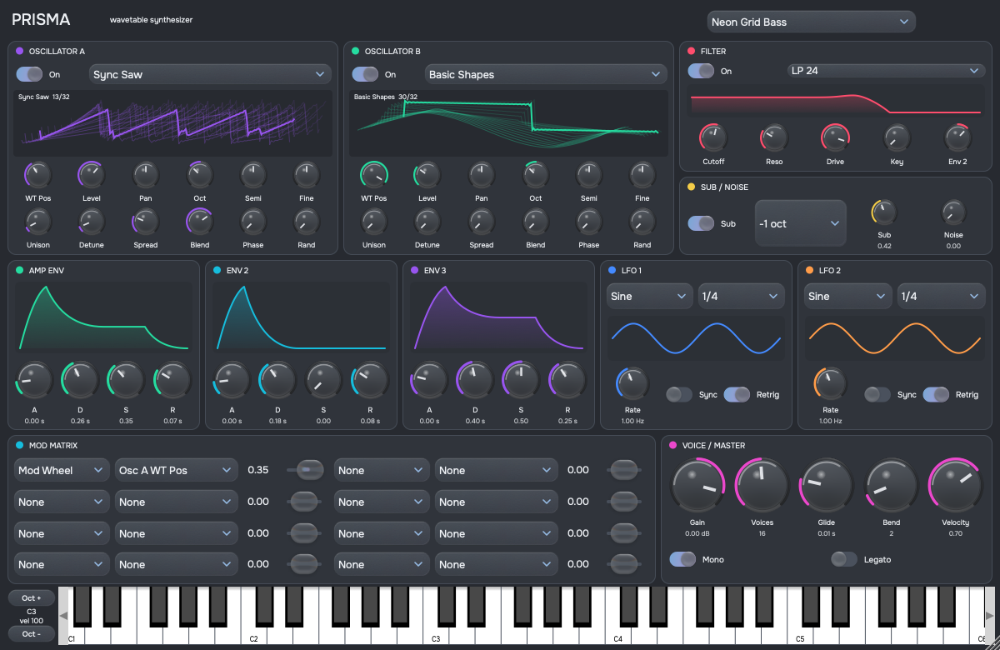 |

| Drum machine · Dark | Export · Light |
|:---:|:---:|
| 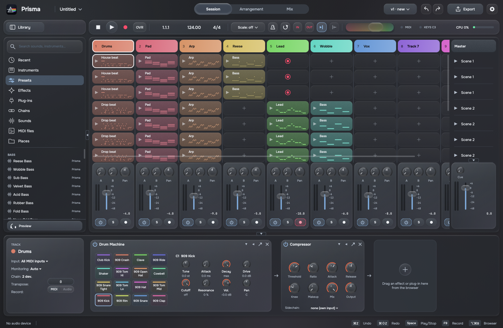 | 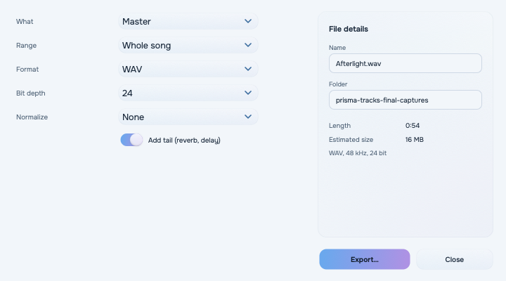 |

| Appearance · Light | Distortion · Dark |
|:---:|:---:|
| 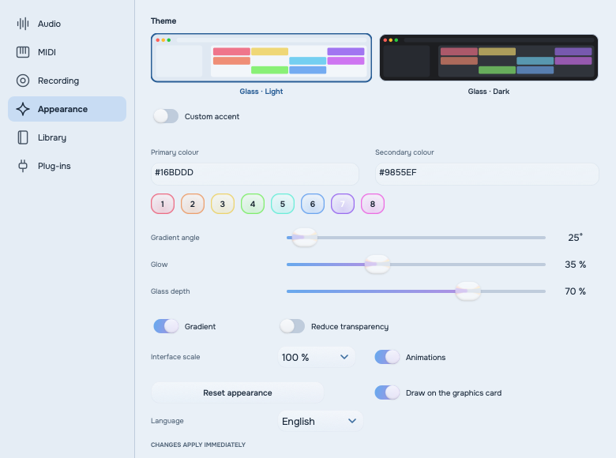 | 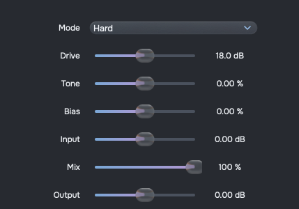 |

<details>
<summary>Arrangement in Glass Light</summary>

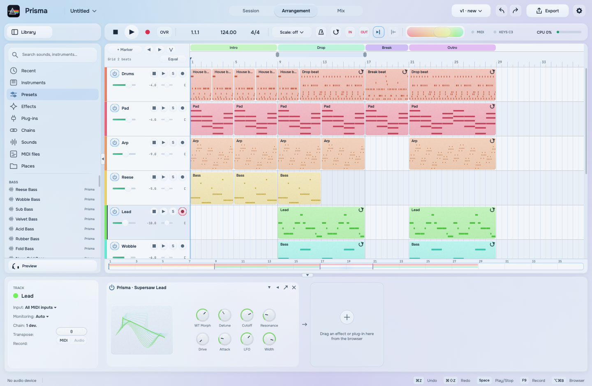

</details>

[All native captures](media/ui-glass/) · [Glass material and accessibility settings](docs/design/GLASS-UI.md)

## Track controls

**Power** turns a track's output on or off in both Session and Arrangement. The state is saved with the project and supports Undo.

**Stop / Resume** suspends one track's clips while the other tracks and transport continue. Click again to return that track to its timeline at the next launch boundary. Session clip stops follow launch quantization. A separate source button switches the track between Session and Arrangement; the header context menu also offers the playback commands.

## Sounds and effects

Prisma includes **44 factory programs**: basses, leads, pads, plucks, keys, organ, bells, strings, brass and evolving FX. Browse them under **Presets**, or use the synth's program menu. The original 16 programs retain their numbers and parameter values.

The cyber bass set adds four driven mono sounds with sub oscillators, glide and filter/wavetable motion:

| Program | Character |
|---|---|
| **Neon Grid Bass** | Short, sharp sync bass with a firm sub layer |
| **Razor Bass** | Sustained folded tone, an upper layer and glide |
| **Chrome Wobble Bass** | Tempo-synced filter and wavetable movement |
| **Overload Bass** | Detuned sync/fold layers, heavy drive and a moving texture |

Use the modulation wheel to reshape the tone or movement. [Listen to all four](media/audio/cyberbass-demo.wav?raw=true).

**Fourteen effects:** EQ, compressor, gate, limiter, reverb, delay, Saturator, Distortion, bitcrusher, filter, chorus, flanger, phaser and autopan. Drag an effect from the browser into a track or master chain.

**Distortion** opens in Hard mode at 18 dB drive, using the existing 8× oversampled drive engine with level compensation. Mode, drive, tone, bias, input, mix and output are available through the standard effect controls; device bypass, automation and project state use the shared effects framework.

## Glass appearance

**Glass · Light** uses a silver-blue ground with soft lavender light. **Glass · Dark** uses graphite with restrained blue and lavender reflections. Matte tracks, floating device cards and clear moving controls share the same layout and gestures.

Settings → Appearance controls theme, two accent colours, gradient, glass depth, glow, UI scale and animations. **Reduce transparency** provides opaque surfaces. Appearance is saved separately from the musical project. English is the default language; Russian is available after a restart.

## Listen

- **[Cyber bass audition · WAV](media/audio/cyberbass-demo.wav?raw=true)** — Neon Grid, Razor, Chrome Wobble and Overload, each playing the same 16-beat phrase at 140 BPM. Raw factory sounds; [render details](media/audio/README.md).
- **[Mountain King · MP3](media/demo-mountain-king.mp3?raw=true)** — an electronic arrangement of Grieg's public-domain composition, made with the app's instruments and effects. [Open the project](docs/demo/Mountain%20King.prisma) · [Demo notes](docs/demo/README.md).
- **[Engine demo · WAV](media/prisma_demo.wav?raw=true)** — a song rendered offline by the core engine.

## Download for Mac

**[Download the nightly DMG](https://github.com/Silver-Season/DAW/releases/download/nightly/DAW-macOS.dmg)** · [Release notes](https://github.com/Silver-Season/DAW/releases/tag/nightly) · [SHA-256](https://github.com/Silver-Season/DAW/releases/download/nightly/DAW-macOS.dmg.sha256)

The package contains DAW.app, Prisma AU/VST3/Standalone, and installation notes in English and Russian. Nightly packages follow `main`; features in an open PR become available after merge.

Development builds are signed ad hoc. On first launch, macOS may ask you to allow the app in System Settings → Privacy & Security → Open Anyway.

## Useful keys

| Keys | Action |
|---|---|
| Space / Shift+Space | Play from the start point / continue in Arrangement |
| Tab / Shift+Tab | Session ↔ Arrangement / clip editor ↔ device chain |
| Cmd+T / Cmd+Shift+T | New MIDI / audio track |
| F9 | Record to Arrangement |
| Cmd+Shift+C | Capture the last MIDI phrase |
| Cmd+E / Cmd+J | Split / join |
| Cmd+L | Loop the selection |
| Cmd+U / Cmd+Shift+U | Quantize / quantize settings |
| A | Arrangement automation |
| M | Computer-keyboard MIDI input |
| Cmd+Z / Cmd+Shift+Z | Undo / redo |
| Cmd+F | Search the browser |
| Cmd+, | Settings |
| Cmd+Shift+R | Export |

[Detailed controls and workflows](docs/FEATURE-GUIDE.md)

## Build from source

On macOS, install Xcode or the Command Line Tools, CMake and Ninja:

```bash
brew install cmake ninja
./scripts/build-mac.sh
```

The script fetches JUCE, builds for Apple Silicon and Intel, runs tests and installs the Prisma plugins into `~/Library/Audio/Plug-Ins`. The application is written to `build/app/DAW_artefacts/Release/DAW.app`.

To build without installing plugins:

```bash
cmake -S . -B ../daw-build -G Ninja -DCMAKE_BUILD_TYPE=Release -DPRISMA_COPY_AFTER_BUILD=OFF
cmake --build ../daw-build --parallel
ctest --test-dir ../daw-build --output-on-failure
```

Package a local DMG with `./scripts/package-mac.sh /absolute/build /absolute/out/DAW.dmg`.

The ten ctest suites cover DSP, presets, effects, recording, warp, project state and UI behavior in both languages. Audio is checked numerically; dedicated tests check real-time allocation rules. GitHub CI builds and tests on macOS and Linux, validates the Audio Unit and packages the macOS application.

## Development status

The application is in active development. The separate **Mix**, **Score** and **Step** views are interface placeholders. Current mixing controls live in Session and the device chain.

Next work includes full plugin delay compensation, groups, mouse-driven take comping, snapshots/morph, MIDI Learn, time-signature changes and further synth development. [Roadmap and specs](docs/spec/README.md) · [Current handoff](docs/HANDOFF.md).

| Folder | Contents |
|---|---|
| `core/` | JUCE-free DSP, synths, timing, clips, analysis and effects |
| `app/` | Audio engine, model, projects, plugin hosting and UI |
| `plugins/prisma/` | Prisma AU, VST3 and standalone wrappers |
| `tests/`, `core/tests/` | Engine, UI and numerical audio checks |
| `tools/` | Offline renderers and demo-project tools |

## License

[GNU AGPLv3](LICENSE). Source and derivative works remain available under AGPLv3. Third-party notices are included with the source and packaged builds.
